# Family Learning Games

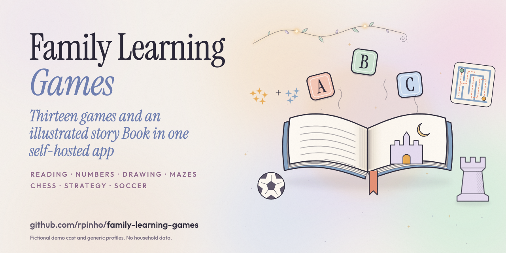

**One app. Thirteen games, The Book and fictional demo worlds.** A single home screen brings together reading, numbers, free drawing, mazes, chess, strategy, soccer, and an illustrated story with little games inside it. Install the hub once, then switch games without another website. This is a **self-hosted source collection**, intended to run on your own computer.

After setup, open **http://localhost:4810/**. Choose a player once; their name stays large at the top and their progress stays separate. Use **Games** to return home, **Refresh** to reload, and **Grown-ups** to change the device's player. The main menu uses illustrated logos; activity menus show gameplay previews. Main-menu order adapts per player from recent local play sessions, including older activities that now belong to Maze Garden or Soccer Club. The menu opens immediately using its last known order (or the default), updates preferences in the background for the next visit, and stays still while choosing.

[Quick start](#quick-start) · [Let an agent install it](#let-a-coding-agent-install-it) · [Explore the games and Book](#thirteen-games-and-the-book) · [Privacy](PRIVACY.md)

What I learned building this: [RETRO.md](RETRO.md)

[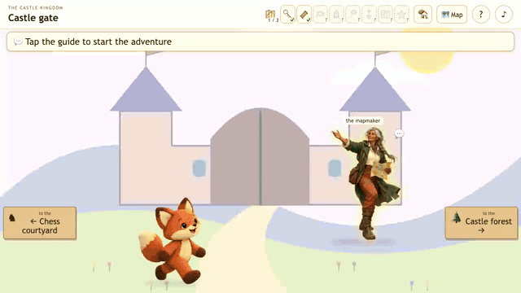](docs/media/highlights.mp4)

[Watch the 10-second highlight video](docs/media/highlights.mp4) · Silent · Recorded from real play with fictional players

**Edition note:** the World and Book pictures and clips came from a household installation with the optional local art worker, using public characters and fictional players. A fresh install has the games, but no chapters or playable World. Painted scenes need a separately configured local art worker and a reviewed painting library with hero art; chapters also need the optional writer. Personal paintings and recordings stay private.

## Thirteen games and The Book

**[Rook Academy](hub/CHESS.md)** offers 36 First moves lessons, 189 Small steps lessons that grow from sparse boards into full positions, and a 72-lesson advanced continuation in two difficulty bands, with an original speaking coach, hints, review and local practice games. **Maze Garden** gathers four activities: tracing mazes, Make a Maze, letter labyrinths and obstacle rescues. **Soccer Club** gathers three soccer variants. Choose any version; existing progress is preserved.

Drag, trace, steer, aim, and think ahead. Pick an activity and a manageable challenge, then play together.

<table>
<tr>
<td colspan="2" valign="top">
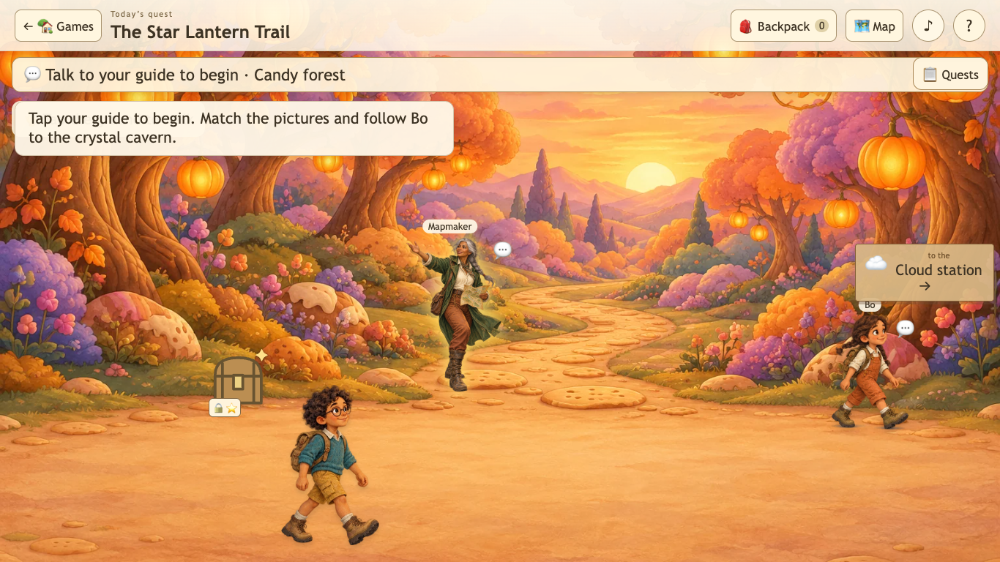 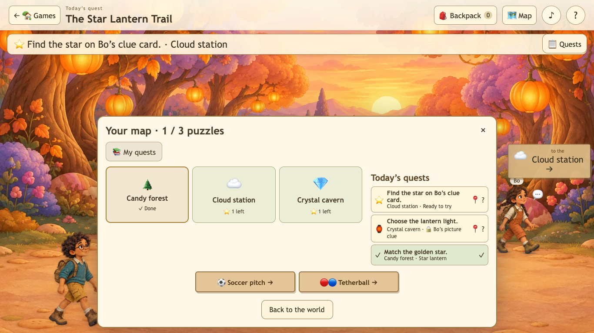<br>
<strong>The Castle Kingdom — a world to explore together.</strong><br>
Explore painted places, talk to friends, collect tools, and solve little challenges in your own order. <a href="docs/media/world-quest-play.mp4">Watch a quest being played</a> (19 seconds, silent). Walking paths stay open; keys and tools still matter at real locks. The map reveals places as you visit; restoring its three pieces opens the castle treasure. A public-safe, memory-only preview is included: run <code>node docs/showcase/demo-server.mjs</code>, then open <code>http://localhost:5710/world?player=hero</code>. This pastel preview is separate from the standard hub installation. The painted captures above require the optional local art worker and reviewed painting library; a fresh hub hides World until its art is ready.
</td>
</tr>
<tr>
<td colspan="2" valign="top">
<a href="book/SCHEMA.md">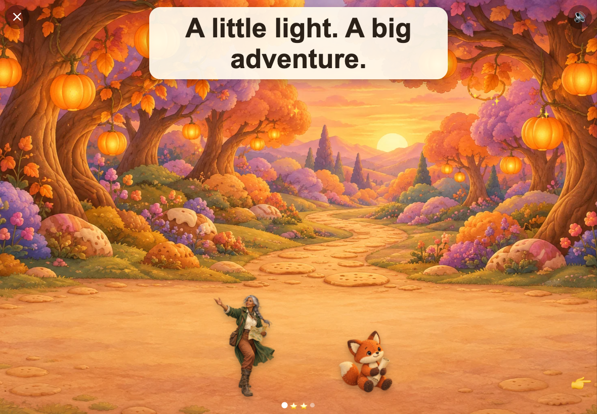<br> 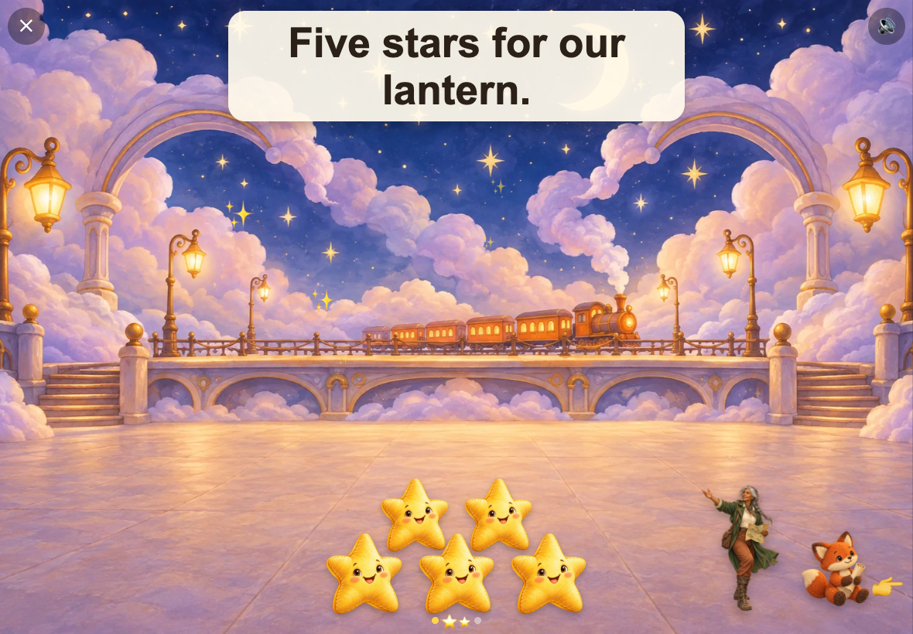 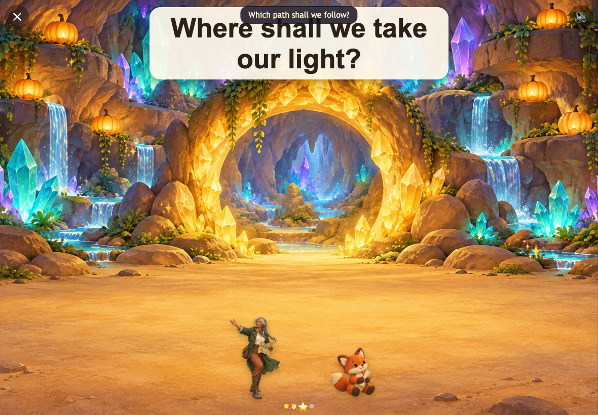</a><br>
<strong>The Book — play inside the story.</strong><br>
The optional nightly writing pipeline creates an illustrated chapter. Tap the stars to count them, pick which path the story takes, and help a friend put the story right. <a href="docs/media/book-story-and-counting.mp4">Watch a chapter being read and played</a> (18 seconds, silent). Letter kicks and magic words are also supported. Grown-ups can preview a chapter without changing progress. A fresh install has no chapter. The local template smoke check creates a quest cover; playing it needs the optional painting library and hero art. The painted captures above used the local art worker.
</td>
</tr>
<tr>
<td width="50%" valign="top">
<a href="games/letter-quest">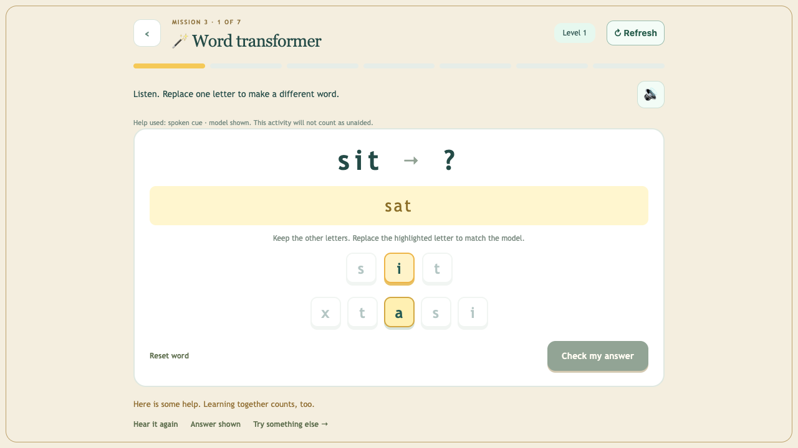</a>
<strong>Letter Quest — words open worlds.</strong><br>
Letter tracing, reading missions, word building and story adventures. After showing a word-change model, the game keeps the other letters and guides the replacement.
</td>
<td width="50%" valign="top">
<a href="games/word-arcade">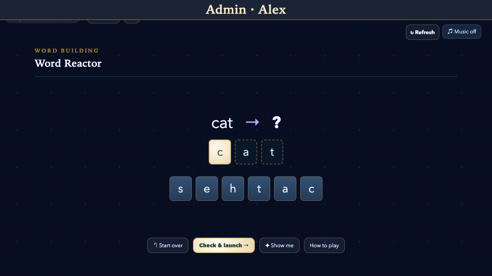</a>
<strong>Word Arcade — spelling takes flight.</strong><br>
Spaceship challenges, word building, rhyme hunts, sorting, and flashcards. Practice or Arcade pace.
</td>
</tr>
<tr>
<td width="50%" valign="top">
<a href="games/number-park">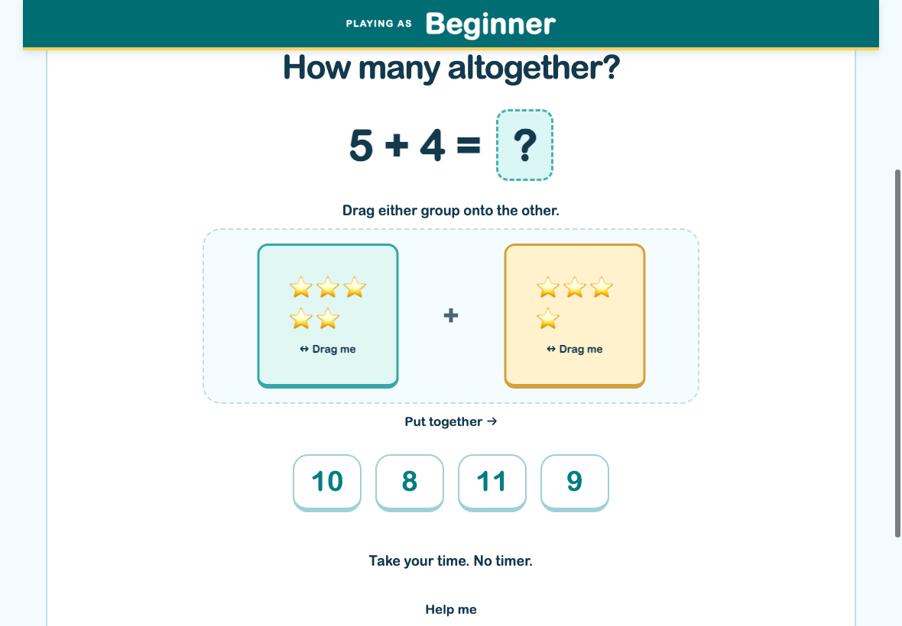</a>
<strong>Number Park — math you can move.</strong><br>
Count objects, combine groups, take away, continue patterns, trace numbers and shapes, and explore reading or harder math.
</td>
<td width="50%" valign="top">
<a href="games/maze-garden">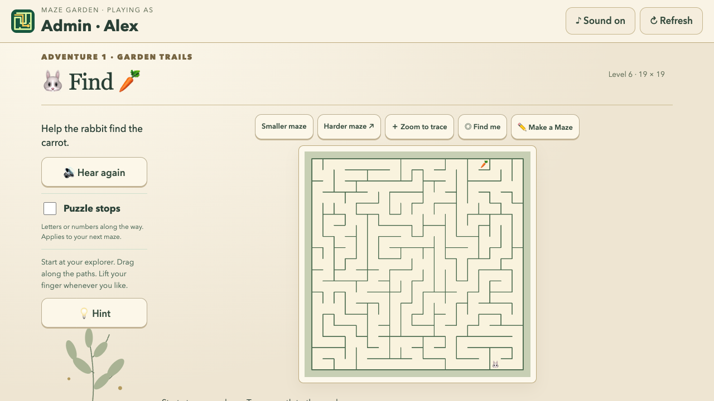</a>
<strong>Maze Garden — find your own way.</strong><br>
Choose tracing mazes, the 3D letter labyrinth, or obstacle rescues. Each keeps its own progress.
</td>
</tr>
<tr>
<td width="50%" valign="top">
<a href="games/three-in-a-row">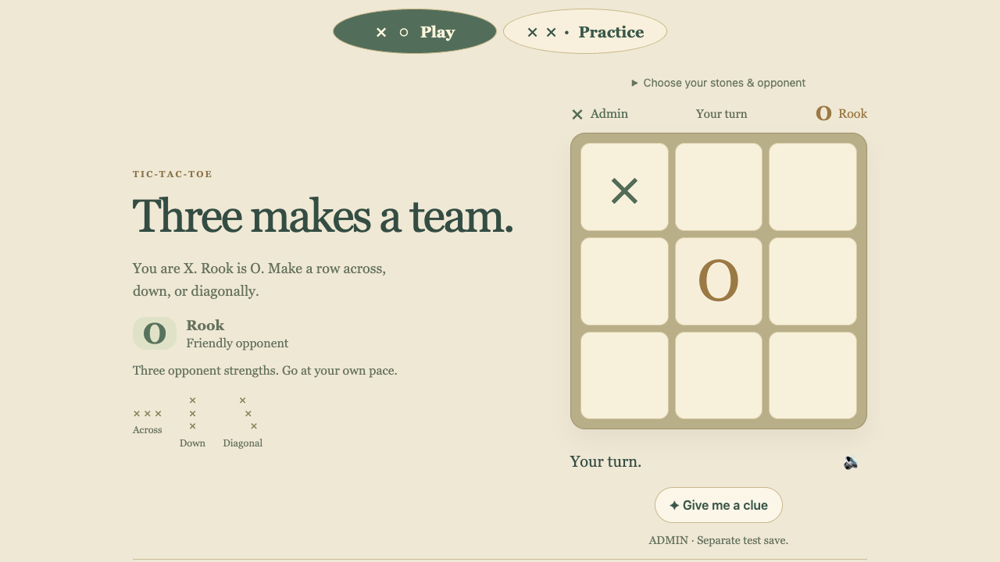</a>
<strong>Three in a Row — think one move ahead.</strong><br>
Choose X or O, set the opponent's strength, play Rook, and explore one-move practice puzzles and tactical clues.
</td>
<td width="50%" valign="top">
<a href="games/target-trail">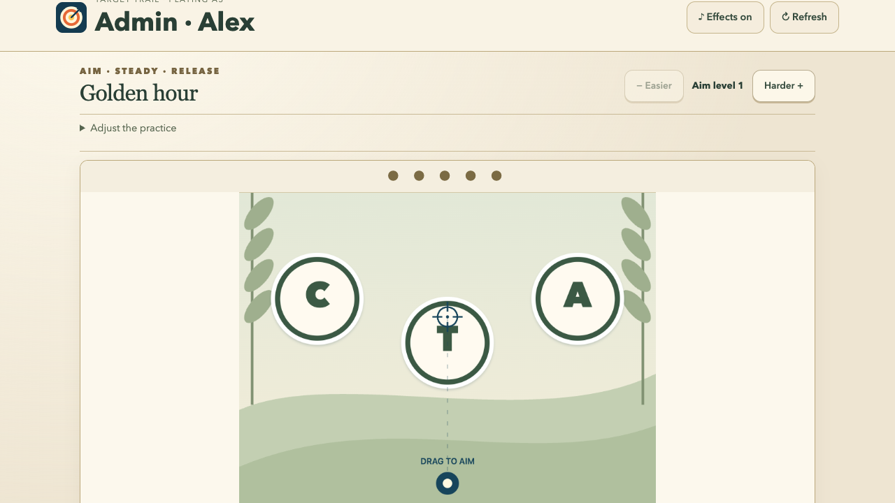</a>
<strong>Target Trail — listen, aim, release.</strong><br>
Spoken letter and word targets with adjustable motion and aiming difficulty. Settings apply immediately.
</td>
</tr>
<tr>
<td width="50%" valign="top">
<a href="hub/CHESS.md">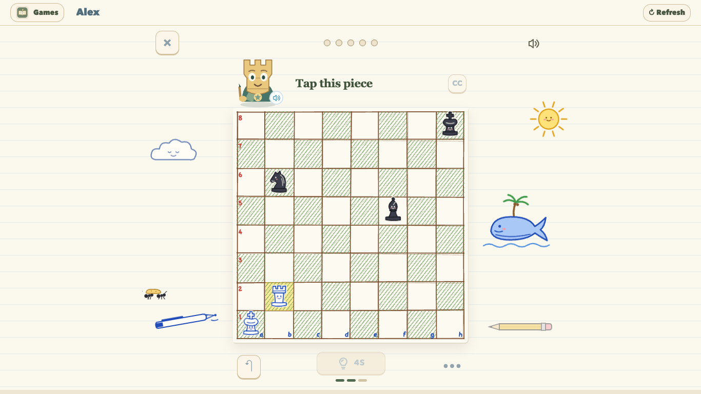</a>
<strong>Rook Academy — your next good move.</strong><br>
Short tactical positions, a winding lesson path, a graduated short-lesson course, two advanced bands, review and practice games.
</td>
<td width="50%" valign="top">
<a href="hub/README.md#dribble-duel">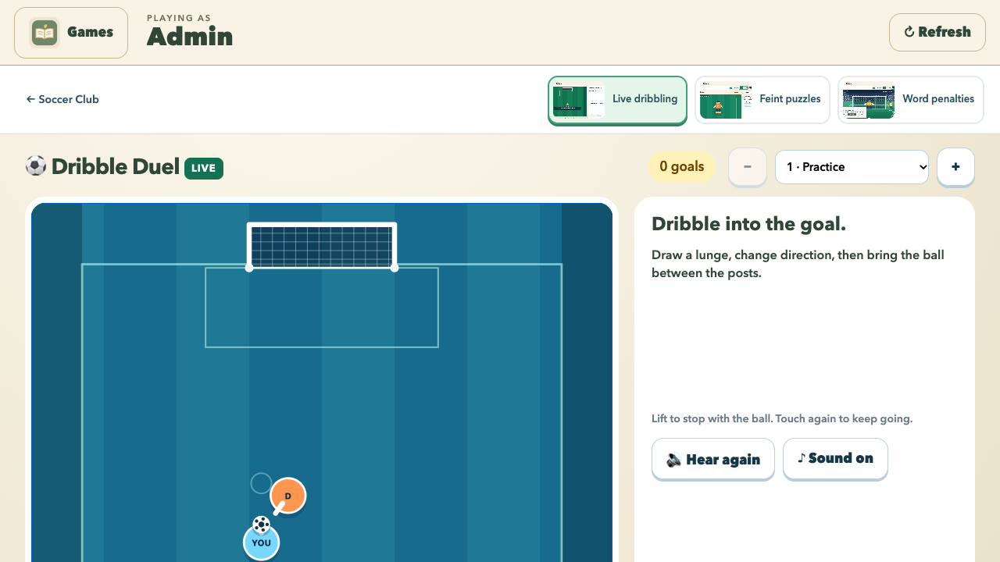</a>
<strong>Soccer Club — three ways to play.</strong><br>
Choose live dribbling, feint puzzles, or word penalties. Existing saves stay separate.
</td>
</tr>
<tr>
<td width="50%" valign="top">
<a href="games/number-park">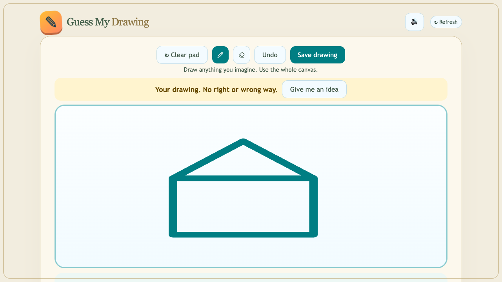</a>
<strong>Guess My Drawing — a canvas of its own.</strong><br>
Draw freely, ask the local picture model to guess, choose another idea, and correct a guess without losing points.
</td>
<td width="50%" valign="top">
<a href="games/target-trail">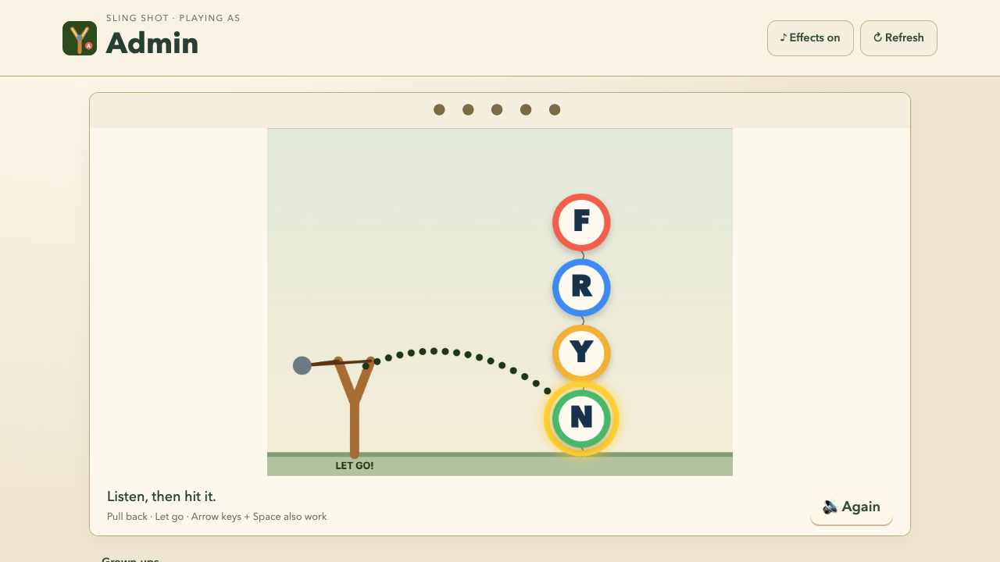</a>
<strong>Sling Shot — pull back and let go.</strong><br>
Aim for the spoken letter, number, pattern, times-table answer or next spelling letter.
</td>
</tr>

<tr>
<td colspan="2" valign="top">
<a href="hub/README.md#free-build-word-search-and-word-blocks">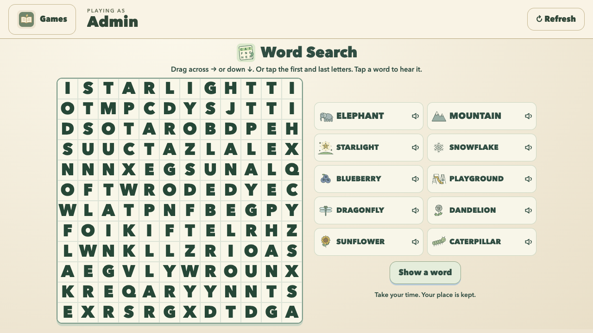 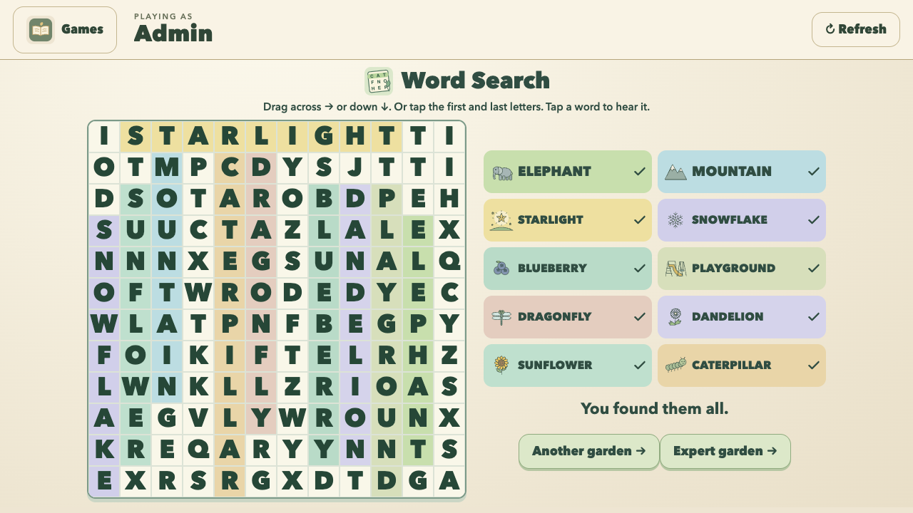</a><br>
<strong>Word Search — a picture for every word.</strong><br>
Start with small gardens and grow to 12×12. Find pictured words across and down, then try backwards and diagonal paths as the gardens grow. Expert hides the written clues and adds two near misses. Tap a clue to hear device pronunciation; available voices vary by browser.
</td>
</tr>
<tr>
<td width="50%" valign="top">
<a href="hub/README.md#free-build-word-search-and-word-blocks">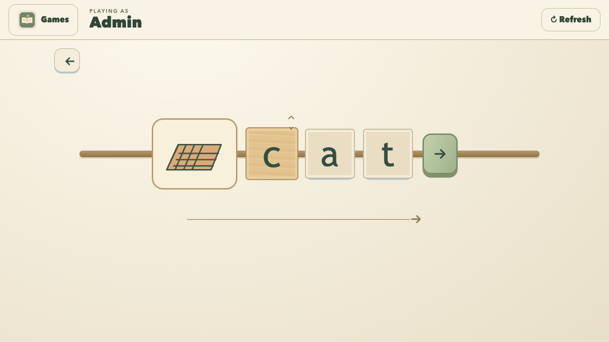</a>
<strong>Word Blocks — give the letters a turn.</strong><br>
Rotate blocks to spell pictured words, put pictured sentences together, or pair number coins. Three activities on one shelf.
</td>
<td width="50%" valign="top">
<a href="hub/README.md#free-build-word-search-and-word-blocks">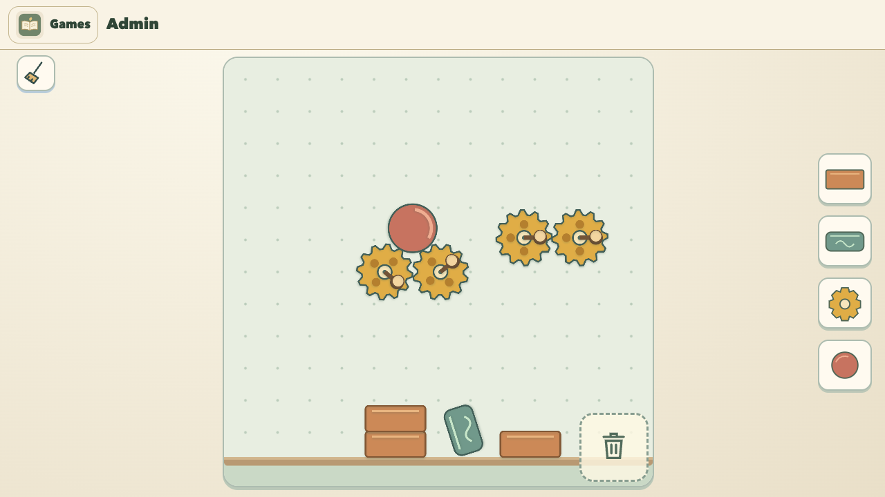</a>
<strong>free build — see what happens.</strong><br>
Stack blocks, drop a ball, add a bounce and spin a gear train. Build freely and return to the room you left.
</td>
</tr>

</table>

The showcase uses original generic pastel SVG scenes, an independently invented mapmaker and a plush fox; no child stand-ins appear in these captures. Its nightly generation and optional local narration need separate setup; <code>npm run play</code> starts the games and chapter player, without automatically writing chapters. The <a href="book/SCHEMA.md">chapter and picture-library guide</a> explains the setup. The public player supports tapping painted objects and keys flying into opening castle doors, with a treasure chest reveal. Branching-ending helpers remain separate from public playback. These captures use the current public player and an authored fictional chapter; <a href="docs/showcase/README.md#fictional-preview">edition differences</a> are documented.

*Actual gameplay from an isolated, generic Admin demo. Click a card for its game guide. No children's profiles or drawings are shown; the house doodle is newly scripted; screenshots are not evidence of learning outcomes.*

The current edition also includes the calm theme, two home pages, balance challenges, expanded patterns, and a World with inventories, room paths and revision-checked quests. The [fictional demo worlds](hub/WORLD.md) use the original public cast and generic pastel scenes. Private daily content, artwork and recordings are supplied separately by each installation.

### Made for playing together

- **Touch-friendly:** drag objects, trace paths, steer a spaceship, and aim with a finger.
- **Choose the challenge:** separate Beginner and Explorer presets; adjustable or adaptive challenges vary by game.
- **Keep progress local:** saved rounds and diagnostics live on your own server. No ads or game-owned analytics.
- **One icon:** one installed home screen for all thirteen games and the Book; no separate installs needed.
- **Easy to start:** one setup command for the whole collection. No AI API key required.

## Pick a game

| Game | What is inside | Default local link |
| --- | --- | --- |
| [Letter Quest](games/letter-quest) | Letter tracing, reading practice and stories | http://localhost:4810/#letter-quest |
| [Word Arcade](games/word-arcade) | Moving spaceship challenges, word building, rhymes and flashcards | http://localhost:4810/#word-arcade |
| [Number Park](games/number-park) | Counting, patterns, manipulatives, tracing, reading and harder math | http://localhost:4810/#number-park |
| [Guess My Drawing](games/number-park) | Wide free drawing, local picture guesses and varied drawing ideas | http://localhost:4810/#drawing-studio |
| [Maze Garden](games/maze-garden) | Tracing mazes, Make a Maze, 3D letter labyrinths and obstacle rescues | http://localhost:4810/#maze-garden |
| [Three in a Row](games/three-in-a-row) | Tic-tac-toe against Rook and one-move practice puzzles | http://localhost:4810/#three-in-a-row |
| [Target Trail](games/target-trail) | Moving targets, adjustable aiming difficulty and spoken letters/words | http://localhost:4810/#target-trail |
| [Sling Shot](games/target-trail) | Pull back and let go: hit the spoken letter, number, pattern, times-table answer or next spelling letter | http://localhost:4810/#sling |
| [Rook Academy](hub/CHESS.md) | 270 lessons across beginner and advanced paths, review and local practice games | http://localhost:4810/#chess |
| [Soccer Club](hub/README.md#dribble-duel) | Live dribbling, feint puzzles and word penalties | http://localhost:4810/#dribble-duel |
| [free build](hub/README.md#free-build-word-search-and-word-blocks) | Stack blocks, bounce balls and spin connected wooden gears | http://localhost:4810/#free-build |
| [Word Search](hub/README.md#free-build-word-search-and-word-blocks) | Find pictured words in gardens up to 12×12; optional Expert picture clues | http://localhost:4810/#word-search |
| [Word Blocks](hub/README.md#free-build-word-search-and-word-blocks) | Turn spelling blocks, match pictured sentences, and pair number coins | http://localhost:4810/#word-blocks |
| [Letter Slalom](games/word-arcade) | Part of Word Arcade: ski or snowboard through the letter you hear | http://localhost:4810/#letter-slalom |
| [The Book](book/SCHEMA.md) | Illustrated chapters, counting, letter kicks and magic words; separate chapter setup | Grown-ups → Watch; Admin can preview chapters |

## Run on your computer

### Quick start

With **Node.js 22.13 or newer**, npm, and Git installed, copy the clone URL from this page’s GitHub **Code** menu, replace `REPOSITORY_URL` below, and paste this command into Terminal (macOS/Linux) or PowerShell 7:

```sh
git clone REPOSITORY_URL && cd family-learning-games && npm run play
```

This downloads the collection, installs locked dependencies, builds the two React interfaces, and starts the hub plus the game servers. The hub and other games need only Node. Open **http://localhost:4810/** in Chrome, Edge, or another modern browser. On the first visit, a **grown-up** completes Family setup: add each child, choose a starting point, and optionally add interests and photos. You can save a child with **zero photos**. Add another child before opening Games. Later, use **Grown-ups → Family setup** to edit a child or add one.

Choose **skip for now** to play with demo players Beginner and Explorer, then set up later under **Grown-ups → Family setup**.

Tablet previews with fictional children: [child details](docs/media/onboarding-child-tablet.png), [starting skills](docs/media/onboarding-skills-tablet.png), [optional photos](docs/media/onboarding-photos-tablet.png).

Keep the terminal running; Ctrl+C stops the servers. Later, run `npm start` in the same folder; no reinstall is necessary. An existing `family-learning-games` folder is not overwritten.

If you download the repository ZIP instead, unzip it, open a terminal in its folder, and run **`npm run play`**. Prerequisites are not silently installed and no administrator access is required by the game installer.

### Let a coding agent install it

Give your agent this request:

> Install and run this repository locally (use its clone URL from the Code menu). Consult its AGENTS.md and README first. Check Node/npm, use a new folder, run npm run play, verify all thirteen games through the hub and the optional Book preview, and give me the single home-screen link. Keep it private and preserve any existing saves.

[AGENTS.md](AGENTS.md) contains the installation, verification, data-preservation and privacy instructions. No API key or paid AI service is needed to run the games.

After onboarding, choose a child by name; each has separate saves. Before setup, the public demo presets are **Beginner**, **Explorer**, and **Admin**. Add `/?player=beginner` or `/?player=explorer` to a link to open that preset. Explicit preset links work before Family setup, using generic content. free build, Word Search and Word Blocks need no Book, cast, word pack, voice cache or model account. Beginner and Explorer have different starting challenges and separate saves; Admin is for testing. Child profiles and demo presets are shared within your installation, not authenticated personal accounts. Spelling names in exercises are fictional examples.

To run just one game, run `npm start` inside its directory (for the React games, first run `npm ci` and `npm run build`). Individual servers use their original default ports, listed in their READMEs. Run `npm test` from the collection root after setup to check every game, hub, Book and script suite. Browser tests find an installed Chrome, or use `CHROME=/path/to/chrome npm test`. If none is found, they report a skip. Optional privacy-tool integration tests also skip when their tools are absent; publication checks still require those tools.

## Play on a tablet or Chromebook

By default the servers accept connections only from the computer running them. For a **trusted private Wi-Fi network**, on macOS/Linux:

```sh
HOST=0.0.0.0 npm start
```

Keep the host computer awake and on the same private Wi-Fi as the tablet or Chromebook. Find its Wi-Fi/LAN address in the computer’s network settings, then open `http://YOUR-COMPUTER-LAN-ADDRESS:4810/` in the device’s browser. Complete Family setup as a grown-up there, or choose a child already added on the host. The Chromebook needs only a browser when another computer runs the server. On PowerShell, set `$env:HOST="0.0.0.0"` before `npm start`. Only the hub listens on the LAN; the game backends remain loopback-only. Allow the hub connection in your local firewall if necessary. Use your browser's Install/Create app action on **this home screen**, not on individual games. Parental approval may be needed once for this new address/port. Do **not** port-forward or expose these servers to the public internet. They do not have user authentication or internet-facing security hardening. A parent gate prevents accidental taps, not unauthorized access.

The apps include launcher icons and manifests. Installation/fullscreen behavior varies by browser; plain HTTP LAN addresses are not secure origins, so a seamless installable/offline experience is not guaranteed. GitHub Pages alone cannot run the Node save APIs.

## What onboarding asks and why

- **First name or nickname, age or grade:** address the child and give the Book age context; no surname or birthday.
- **Letters, counting, reading and maths facts:** a grown-up’s starting estimate, kept separately from observed gameplay. The optional four-prompt check records “independent”, “with help”, “another day” or “skip”; it does not certify mastery.
- **Interests and favourite things:** themes for the Book and quests. Both are optional.
- **Photos:** entirely optional likeness references. The browser strips image metadata and reduces image size, then saves them on your family’s server. Onboarding never sends them to a model provider. They are accessible to a separately configured **local-only** art worker only when you enable the photo permission; games and text generation work without them.

The grown-up gate prevents accidental taps; it is not authentication. On a shared LAN, only use this with people you trust. Data stays until you remove it; use **Remove saved photos** in an edit to delete those images. Private backups may retain copies. See [PRIVACY.md](PRIVACY.md).

## Optional nightly quests and chapters

Games need no AI account. For fresh chapters, a grown-up can separately enable the writer using the family’s own model subscription. [Install for your family](AGENTS.md#enable-the-nightly-quest-writer-optional) gives the login, manual verification and scheduler commands. The text writer sends selected names, interests, learning context and day notes to the selected provider; **it never sends photo bytes**. Voice generation and a custom local art worker are separate optional setups.

## Privacy and saves

This release starts from fresh public history. It includes no real children's names, household logs, saved profiles, drawings, reports, contact details, credentials, or private deployment settings.

The launcher saves new local progress and diagnostics in **`.data/<game>/`**, which is ignored by Git. Family setup writes **`.data/book/profiles.json`**, **`.data/book/cast.json`**, **`.data/learner/<child>.json`**, and optional **`.data/book/photos/<child>/`**. To keep all of this in a different private folder, set `FAMILY_DEPLOY_ROOT` to that folder every time you run the hub or nightly writer. Existing `FAMILY_BOOK`/`FAMILY_LEARNER` overrides are honoured; onboarding writes only when both stay inside that private root. A game started individually uses its own directory under `~/.local/share/family-learning-games/`, unless its data environment variable is supplied. Never upload these data directories or attach raw logs/drawings to public issues. Save a backup before changing or removing local data.

Gameplay and drawing recognition run on your own server. There is no embedded API key, account requirement, advertising, chat, or third-party analytics. Browser narration may use a browser/vendor speech service; local voices are preferred when available, but offline speech is **not guaranteed**. See [PRIVACY.md](PRIVACY.md) and [SECURITY.md](SECURITY.md).

## Audio and learning limitations

Most games in the shared edition use device/browser narration instead of private voice caches. Voice quality and accent vary. **Rook Academy uses optional locally generated stock narration and stays text-only when clips are unavailable; it never falls back to device speech.** See its [audio setup](hub/CHESS.md). In Number Park Reading, the fallback says **letter names with example words**, not isolated phonemes: a grown-up should model the actual sounds and blending. It is not equivalent to a professionally recorded phonics course.

Word Arcade includes original synthesized music loops and CC0 laser effects. Private-use songs, third-party character recordings and extracted instructional audio are not included. [Third-party notices](THIRD_PARTY_NOTICES.md) document the included assets and drawing model.

These are experimental practice games, not validated educational assessments or medical/occupational-therapy tools. Scores, tracing success and engagement do not establish mastery or transfer to paper. Drawing guesses can be wrong. Play together, let the child choose a manageable challenge, and check skills away from the screen.

## References

The games stand on other people's work. [THIRD_PARTY_NOTICES.md](THIRD_PARTY_NOTICES.md) carries the full provenance and licenses. The main sources:

- [chess.js](https://github.com/jhlywa/chess.js): move generation and rules in Rook Academy.
- [Stockfish](https://github.com/official-stockfish/Stockfish), through [stockfish.js](https://github.com/nmrugg/stockfish.js): the local engine that plays and scores positions.
- [Lichess puzzle database](https://database.lichess.org/) (CC0): the tactics positions.
- [RhosGFX](https://rhosgfx.itch.io/) chess pieces ([CC0](https://creativecommons.org/publicdomain/zero/1.0/)): the classic piece set.
- [The Quick, Draw! Dataset](https://github.com/googlecreativelab/quickdraw-dataset), Google ([CC BY 4.0](https://creativecommons.org/licenses/by/4.0/)): the feature vectors that let the games guess what a drawing shows.
- [Kenney's Sci-fi Sounds](https://kenney.nl/assets/sci-fi-sounds) (CC0): the Word Arcade laser effects.
- [shadcn/ui](https://ui.shadcn.com/): the vendored UI primitives.

## Contributing and reuse

Bug reports should use an Admin preset with synthetic examples. Include the game, steps, browser and expected behavior; omit names and personal data. Run `npm run check:privacy` before publishing changes. The scanner is a guardrail, not proof that a change contains no private information.

A project-wide reuse license has not been selected yet; public visibility is not a blanket redistribution or commercial-use license. Third-party assets retain the licenses in their notices.
